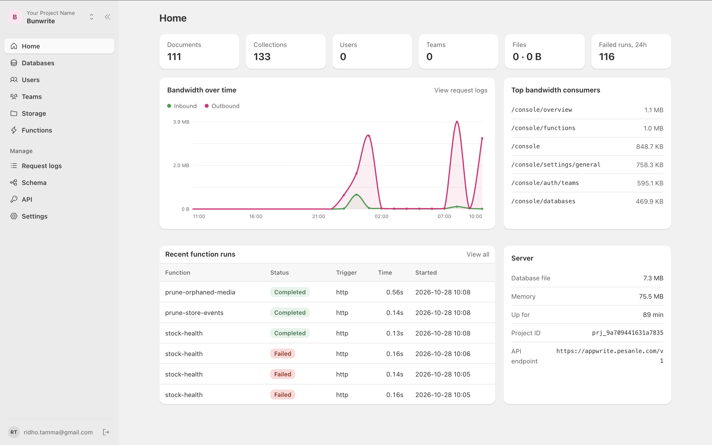

# Bunwrite

**A lightweight, Appwrite-compatible backend on Bun + SQLite + Drizzle.**

Bunwrite is a self-hosted backend for small products and small VPSes. One Bun
server provides the API, console, realtime, functions, sites, storage and
rendering. Existing [`appwrite`](https://www.npmjs.com/package/appwrite) and
[`node-appwrite`](https://www.npmjs.com/package/node-appwrite) SDKs work by
changing the endpoint.

> Bunwrite is an independent open-source project. It is not affiliated with,
> endorsed by, or sponsored by Appwrite.



## Quick start

### Docker

```bash
mkdir -p bunwrite
docker run -it --rm \
  --user 0 \
  --volume /var/run/docker.sock:/var/run/docker.sock \
  --volume "$(pwd)/bunwrite:/usr/src/code/bunwrite:rw" \
  --entrypoint=install \
  ghcr.io/ridhotamma/bunwrite:latest
```

### From source

```bash
git clone https://github.com/ridhotamma/bunwrite.git
cd bunwrite
bun install
cp .env.example .env
bun run dev
```

Open `http://localhost:8080/console/setup` to create the first admin. The API is
at `http://localhost:8080/v1`.

For a throwaway instance with sample data:

```bash
bun run demo
# http://localhost:8790/console
# demo@bunwrite.test / demo-password
```

Deployment, upgrade, backups, TLS and production tuning:
[docs/DEPLOY.md](docs/DEPLOY.md). Every environment variable:
[docs/CONFIGURATION.md](docs/CONFIGURATION.md).

## Features

- **Appwrite-compatible API** for documents, users, teams, storage, functions,
  sites, realtime, webhooks and the console.
- **Localization** with Appwrite's Locale API, plus per-language email
  templates and magic URL sign-in.
- **SQLite by default**, with Postgres supported through the same service layer and an offline `migrate:postgres` command.
- **Functions** for Node.js and Python, with builds, schedules, executions and
  custom domains.
- **Sites**, static or server-rendered, with Git deployments, previews and custom
  domains.
- **Storage and backups** on local disk or any S3-compatible bucket.
- **Vectors and RAG** with local or OpenAI-compatible embeddings, hybrid
  BM25 + vector retrieval, an optional Qdrant ANN index, local or HTTP
  reranking, point-level ACLs, persisted golden-set evaluation, PII redaction,
  prompt-injection signals and audit trails. PDF, image, Markdown and office
  documents are converted to text before embedding; scanned pages can be OCR'd
  with Tesseract and simple tables are preserved.
- **HTML to PDF or image** with headless Chromium.
- **Console, queue, request logs, traces, metrics and feature flags** built in.

## Documentation

| Topic | Guide |
| --- | --- |
| Configuration and environment variables | [docs/CONFIGURATION.md](docs/CONFIGURATION.md) |
| Deployment, Docker, backups, Litestream and Postgres | [docs/DEPLOY.md](docs/DEPLOY.md) |
| Architecture, request path and API coverage | [docs/ARCHITECTURE.md](docs/ARCHITECTURE.md) |
| SQLite and Postgres backends | [docs/DATABASE.md](docs/DATABASE.md) |
| Sites, SSR and custom domains | [docs/SITES.md](docs/SITES.md) |
| Git deployments and previews | [docs/GIT.md](docs/GIT.md) |
| Queue and workers | [docs/QUEUE.md](docs/QUEUE.md) |
| HTML rendering | [docs/RENDER.md](docs/RENDER.md) |
| Vectors and RAG | [docs/VECTORS.md](docs/VECTORS.md) |
| Observability | [docs/OBSERVABILITY.md](docs/OBSERVABILITY.md) |
| MCP server | [docs/MCP.md](docs/MCP.md) |
| Limits and known differences | [docs/LIMITATIONS.md](docs/LIMITATIONS.md) |
| Performance notes | [docs/PERFORMANCE_PLAN.md](docs/PERFORMANCE_PLAN.md) |
| Code conventions | [docs/CONVENTIONS.md](docs/CONVENTIONS.md) |
| Security policy | [SECURITY.md](SECURITY.md) |

## SDK, CLI and MCP

- [`@bunwrite/sdk`](packages/sdk/README.md) — typed client for browsers, Bun,
  Node.js and edge runtimes, including `Vectors` and `RAG`.
- [`@bunwrite/cli`](packages/cli/README.md) — project setup, config pull/push,
  function and site deploys, and every SDK method as a command.
- [`@bunwrite/mcp`](packages/mcp/README.md) — a compact MCP catalog for AI agents.

```bash
npm install @bunwrite/sdk
npm install -g @bunwrite/cli@latest
```

```ts
import { Client, Databases } from '@bunwrite/sdk'

const client = new Client()
  .setEndpoint('https://api.example.com/v1')
  .setProject('your-project-id')
  .setKey(process.env.BUNWRITE_API_KEY!)
```

## AI agents

Bunwrite ships Agent Skills for Claude Code, Cursor, Codex, OpenCode and other
compatible tools:

```bash
npx skills add ridhotamma/bunwrite
```

See [skills/README.md](skills/README.md) for the available skills.

## Development

```bash
bun install
bun run dev
bun test
bun run build
```

See [CONTRIBUTING.md](CONTRIBUTING.md) before opening a pull request.

## License

MIT. See [LICENSE](LICENSE).
