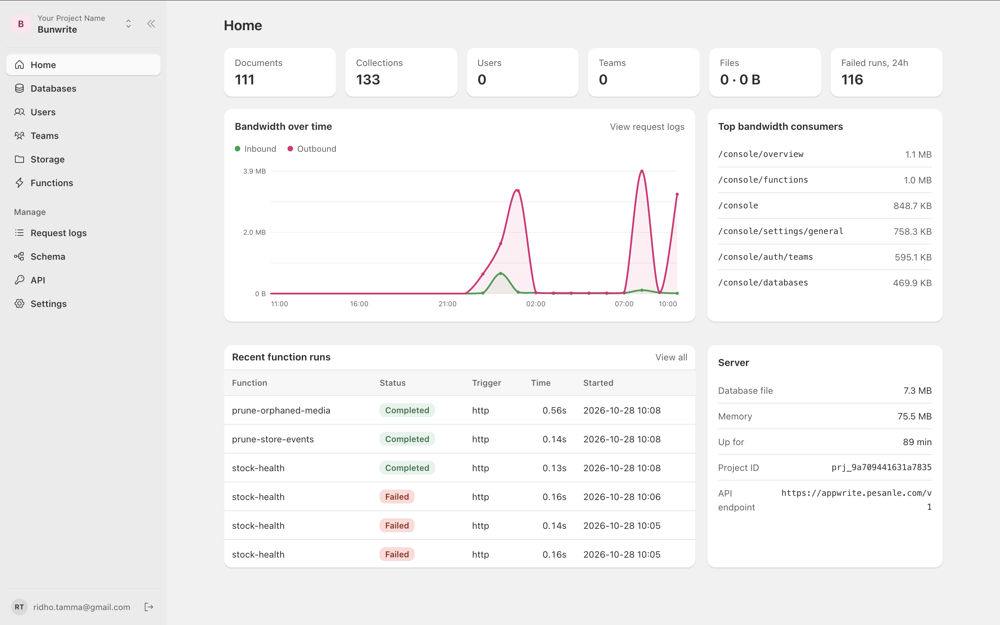
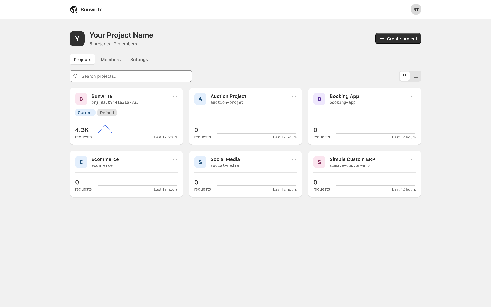

# Bunwrite

**A lightweight, Appwrite-compatible backend on Bun + SQLite + Drizzle.**

Bunwrite is a single-process, self-hosted backend that implements the slice of
the Appwrite API most apps use. Existing apps keep using the official
[`appwrite`](https://www.npmjs.com/package/appwrite) and
[`node-appwrite`](https://www.npmjs.com/package/node-appwrite) SDKs unchanged.

> Bunwrite is an independent open-source project. It is not affiliated with,
> endorsed by, or sponsored by Appwrite.



## Why Bunwrite exists

Bunwrite started from a simple frustration: running an Appwrite-compatible
backend for a small product should not require a container stack, a database
server and a machine bigger than the product itself.

Appwrite's API is excellent, and its SDK ecosystem is the reason Bunwrite can be
a drop-in replacement. Self-hosting Appwrite, however, is aimed at teams with
more infrastructure: Docker and several services, a database server, Redis,
workers, and CPU and memory headroom beyond a small VPS. It also has no switch
for SQLite; its data layer is designed around a database server, not a file you
can copy, inspect and restore.

Bunwrite takes the other trade-off. One Bun server serves the API, realtime,
functions, sites and console; function runs are short-lived child processes.
SQLite is the source of truth. A backup is a consistent snapshot of one file.
And because invoices are a common reason to reach for a backend, HTML-to-PDF and
HTML-to-image rendering are built in instead of being another service or a
Puppeteer dependency in your app.

It is not a fork of Appwrite and is not affiliated with it. Bunwrite implements
the endpoints most apps use and stays compatible with Appwrite's SDKs and CLI.
If you need horizontal scaling, a multi-node database or the complete Appwrite
platform, use Appwrite. If you want the Appwrite API on a small VPS with a file
you can back up, Bunwrite is for you.

## What you get

- **One server, one file.** A single Bun server serves the API, realtime,
  functions, sites and console; function runs are short-lived child processes,
  and SQLite stores everything.
- **Appwrite-compatible.** Point the Appwrite SDK or CLI at Bunwrite and keep
  your existing code and workflow.
- **SQLite-native.** Drizzle migrations create the schema, each project is its
  own database file, and you can inspect or copy the data with standard SQLite
  tools.
- **Environments.** Keep staging and production as separate projects, on one
  server or several. The CLI's `bunwrite env` keeps each environment's
  variables in `.env` files, and previews can have their own values.
- **Backups as a feature.** Create, download and delete consistent snapshots in
  the console; run daily automatic backups; keep them on local disk or in any
  S3-compatible bucket. No separate backup service.
- **Invoices and images built in.** Render HTML to PDF or PNG/JPG/WebP/AVIF/GIF
  with headless Chromium, then return the file or save it to a bucket. No
  Puppeteer or Playwright in your app.
- **Multiple projects.** Each project has its own database, users, teams,
  storage, functions, backups and API keys; switch projects in the console.
- **Admin console included.** Manage databases, users, teams, files, functions,
  webhooks, schema, storage, backups and logs without a separate dashboard.
- **Functions without Docker.** Node and Python functions run in child
  processes with Appwrite's `context` API. Each gets
  `<function-id>.<FUNCTIONS_DOMAIN>` plus any number of custom domains. In the
  Docker image each function builds and runs as its own Linux user, so it cannot
  read the database, uploads or other functions.
- **Sites, static or server-rendered.** Host plain HTML, htmx pages, a built
  single-page app, or an SSR app (`adapter: ssr`) that Bunwrite builds and runs
  on demand, on `<site-id>.<SITES_DOMAIN>` plus any number of custom domains.
  `/api/*` on the site can run a function on the same origin. Project and
  per-site variables apply at build and runtime. See
  [docs/SITES.md](docs/SITES.md).
- **S3-compatible storage.** Uploads and backups can live on local disk or any
  S3-compatible bucket.
- **Auto-tuned.** Sizes image/render/SQLite/upload limits and the JS heap to
  the host's CPU and RAM, including cgroup limits.
- **Small footprint.** Designed for a 1 vCPU / 1 GB VPS.

## Setup from zero

### Requirements

- **Bun 1.4+** for the source install. The standalone binary needs no runtime.
- **Node.js 20+** if you install `@bunwrite/cli` globally; Bun works too.
- **Optional:** Chrome or Chromium for HTML rendering, `python3` for Python
  functions, and Docker if you prefer the Compose deployment.
- No MariaDB, Redis or Docker is required for the single-process install.

### 1. Install and start

```bash
git clone https://github.com/ridhotamma/bunwrite.git
cd bunwrite
bun install
cp .env.example .env

# set DOMAIN for a public server; leave it empty for localhost
bun run dev
```

The example only shows the settings most deployments change. Every option,
default and tuning knob is in
[docs/CONFIGURATION.md](docs/CONFIGURATION.md).

The API is at `http://localhost:8080/v1` and the console is at
`http://localhost:8080/console`.

For production, build the standalone binary with the migrations, console assets
and function runners embedded:

```bash
bun run build             # dist/bunwrite
./dist/bunwrite           # API at http://localhost:8080/v1
```

Build on the target OS and architecture so native dependencies match. The
resulting binary needs no Bun at runtime. See [docs/DEPLOY.md](docs/DEPLOY.md)
for Ubuntu, systemd and Docker Compose.

Want a throwaway instance with sample data instead?

```bash
bun run demo            # http://localhost:8790/console
                        # demo@bunwrite.test / demo-password
```

### 2. Create the first admin

On a fresh database, open `/console/setup` to create the first admin. The page
also shows the generated organization ID, project ID, signing secret and initial
API key; save the project ID and API key for your app.

You can create the admin from the command line instead:

```bash
bun run console:admin you@example.com
```

After the first start, the database is the source of truth. Manage the project,
API keys, allowed origins, email, OAuth sign-in and other application settings
in the console. The optional "First start only" values at the end of
`.env.example` can seed an empty database, then are ignored.

### 3. Install the Bunwrite CLI

```bash
npm install -g @bunwrite/cli@latest
bunwrite --version

# Without a global install, from your app folder:
npx @bunwrite/cli@latest --help
```

On a server, `bunwrite` may already be the standalone server binary. The npm
package is the project CLI for your development machine. If the names collide,
run the CLI as `npx @bunwrite/cli@latest ...`; the examples below use
`bunwrite` after a normal global install.

### 4. Link the folder with `init`

```bash
bunwrite login --endpoint http://localhost:8080/v1 --email you@example.com
bunwrite init project --project-id <project-id>
```

Or use an API key:

```bash
bunwrite client --endpoint http://localhost:8080/v1 --project-id <project-id> --key <api-key>
bunwrite init project --project-id <project-id>
```

`init project` writes `bunwrite.config.json` to the folder. It uses
`bunwrite.json` when that exists, and keeps an existing `appwrite.config.json`
when either is absent. `--create --project-name <name>` creates the project when
you are signed in as a console admin.

### 5. Add the agent skills

Run this in the app folder you want your coding agent to work in:

```bash
npx skills add ridhotamma/bunwrite
```

Or let the Bunwrite CLI install them with the same Skills CLI:

```bash
bunwrite skills
bunwrite init skill
```

`init project` offers to install the skills after linking; pass `--skills` to
skip the question or `--no-skills` to skip the install. See [AI agents](#ai-agents)
for the available skills and flags.

### 6. Define and push resources

Use the console, or keep the schema in the config:

```bash
bunwrite pull all
# edit tables, functions and sites in bunwrite.config.json
bunwrite push tables
bunwrite push functions
bunwrite push sites
```

The example schema can seed the default project:

```bash
bun run schema:push examples/appwrite.config.json
```

A pulled config pushes back with "no changes". Collection and function changes
made in the console are live immediately; export them to the config to keep the
repository in step.

### 7. Connect the app

```bash
npm install @bunwrite/sdk
```

Or keep using `appwrite` / `node-appwrite` and point the endpoint at Bunwrite.
See [Connect an app](#connect-an-app).

### 8. Turn on optional features

- **Backups:** open **Settings → Backups** in the console and create a manual
  snapshot or enable daily automatic backups. See [Backups](#backups).
- **HTML rendering:** install Chromium, then enable it under **Settings → HTML
  rendering**. See [HTML rendering for invoices](#html-rendering-for-invoices).
- **S3 storage:** configure the bucket under **Settings → File storage**, or in
  the environment for backups.
- **Python functions:** set `BUNWRITE_WITH_PYTHON=true` in the Docker image, or
  install `python3` on the host.

## Site and function domains

Sites and functions have a default address plus any number of custom domains:

- A site answers on `<site-id>.<SITES_DOMAIN>`.
- A function answers on `<function-id>.<FUNCTIONS_DOMAIN>`.

With `DOMAIN=example.com` the defaults are `sites.example.com` and
`functions.example.com`, so `landing` is at
`landing.sites.example.com` and `hello` is at
`hello.functions.example.com`. The prefixes are configurable:

```bash
SITES_PREFIX=sites          # landing.sites.example.com
FUNCTIONS_PREFIX=functions  # hello.functions.example.com

# Or override the whole base domain:
SITES_DOMAIN=web.example.com
FUNCTIONS_DOMAIN=api.example.com
```

Without `DOMAIN`, development uses `sites.localhost` and
`functions.localhost`.

To attach custom domains, use **Console → Sites / Functions → Settings**, send
a `domains` array when creating or updating a site/function, or use Appwrite's
proxy API:

```bash
curl -X POST https://api.example.com/v1/proxy/rules/site \
  -H "X-Bunwrite-Project: $PROJECT_ID" \
  -H "X-Bunwrite-Key: $API_KEY" \
  -H "Content-Type: application/json" \
  -d '{"domain":"www.example.com","siteId":"landing"}'

curl -X POST https://api.example.com/v1/proxy/rules/function \
  -H "X-Bunwrite-Project: $PROJECT_ID" \
  -H "X-Bunwrite-Key: $API_KEY" \
  -H "Content-Type: application/json" \
  -d '{"domain":"api.example.com","functionId":"hello"}'
```

Each resource keeps its default address, so removing a custom domain never
takes the site or function offline. Point wildcard DNS records
(`*.sites.example.com` and `*.functions.example.com`) and every custom domain
at the server; the bundled Caddy obtains certificates on demand.

## Appwrite CLI

The [Appwrite CLI](https://appwrite.io/docs/tooling/command-line/installation)
(tested with 22.0.0) works against Bunwrite. Either point it at a project with an
API key:

```bash
appwrite client --endpoint http://localhost:8080/v1 --project-id your-project-id --key your-api-key
```

or sign in with a console admin (`bun run console:admin you@example.com`) and
link the folder to a project. Settings need the sign-in; everything else works
with either:

```bash
appwrite login --endpoint http://localhost:8080/v1 --email you@example.com --password '...'
appwrite init project --organization-id <org-id> --project-id <project-id> --project-name <name>
```

The organization ID is on the console's Organization page.

| Command | Pull | Push |
| --- | --- | --- |
| `settings` | project name, services, protocols, sign-in methods, security policies, mock phone numbers | same |
| `tables` / `collections` | databases, tables, columns, indexes | create and alter |
| `functions` | settings and the source code of the latest deployment | settings, then deploy and activate the code |
| `buckets` | bucket settings | create and update |
| `teams` | teams | create and rename |
| `webhooks` | webhooks | create and update |
| `topics` | messaging topics | create and update |
| `all` | all of the above | all of the above |

`whoami` and `logout` work too. For scripts, add `--all --force` to push without
questions, and answer the "pull the code?" question with `--no-code` or `y` on
stdin.

Notes for CLI 22:

- Push functions one at a time (`--function-id <id>`): the CLI can mix up
  archives when it packs several functions in the same millisecond.
- `pull teams` saves whole team objects, which the CLI's own config check then
  refuses on push. Keep only `$id` and `name` for each team in
  `appwrite.config.json`. Appwrite behaves the same.
- `init project` tries to clone Appwrite's agent skills from GitHub; without
  network access it prints an error and links the project anyway.

## Connect an app

```ts
import { Client, Databases } from 'node-appwrite'

const client = new Client()
  .setEndpoint('http://localhost:8080/v1')
  .setProject('your-project-id')
  .setKey('your-api-key')

const databases = new Databases(client)
```

The same endpoint works with the browser `appwrite` SDK. `X-Appwrite-*`
headers, sessions, cookies and error shapes follow Appwrite. See
[Bunwrite or Appwrite naming](#bunwrite-or-appwrite-naming) for the webhook
headers and function variables.

## Bunwrite SDK and CLI

Bunwrite also has its own SDK and CLI in `packages/`, each a separate package
with no dependencies and no code shared with the server:

- [`@bunwrite/sdk`](packages/sdk/README.md): one SDK for browsers, Bun,
  Node.js and edge runtimes. Its services and methods are copied from
  Appwrite's Web and Node.js SDKs, keeping only what Bunwrite serves, so
  switching is usually a change of import. Adds `Render` for the HTML-to-PDF
  and image endpoints.
- [`@bunwrite/cli`](packages/cli/README.md): `bunwrite client`, `login`,
  `init project`, `init skill` / `skills`, `pull`/`push` of
  `bunwrite.config.json` (or `bunwrite.json`; Appwrite's
  `appwrite.config.json` works too, same format), function deploys, and one
  command per SDK method.

Both use Bunwrite's names (`X-Bunwrite-*` headers, `bw_session_*` cookies), so
they need a server from this version on.

```bash
npm install -g @bunwrite/cli@latest
# or: npx @bunwrite/cli@latest --help
```

```ts
import { Client, Databases } from '@bunwrite/sdk'
```

```bash
bunwrite client --endpoint http://localhost:8080/v1 --project-id your-project-id --key your-api-key
bunwrite pull all
```

## AI agents

Bunwrite ships [Agent Skills](https://agentskills.io) that teach Claude Code,
Cursor, Codex, OpenCode, GitHub Copilot and other compatible tools how to use
Bunwrite correctly:

- `bunwrite` — endpoint and SDK setup, account sessions, databases and
  documents, permissions, storage, realtime, functions and sites.
- `bunwrite-cli` — `bunwrite init project`, `pull`/`push`, config files,
  function and site deploys, and service commands.
- `bunwrite-functions` — `context.req`/`res`, builds, environment variables,
  executions, cron and debugging.
- `bunwrite-sites` — static deploys, output folders, fallbacks, custom domains
  and `/api/*` functions.

Install them from the project folder with the
[Skills CLI](https://github.com/vercel-labs/skills):

```bash
npx skills add ridhotamma/bunwrite

# choose specific skills and agents without prompts:
npx skills add ridhotamma/bunwrite --skill bunwrite --agent claude-code --yes
npx skills add ridhotamma/bunwrite --list
```

The Bunwrite CLI wraps the same installer:

```bash
bunwrite skills
bunwrite skills --list
bunwrite init skill
bunwrite skills --skill bunwrite --agent cursor
```

`bunwrite init project` offers to install the skills after linking a folder;
`--skills` skips the question and `--no-skills` skips the install. The skills
live in [`skills/`](skills/README.md) as plain Markdown and do not execute code.
Update them with `npx skills update`. If `bunwrite` on your machine is the
standalone server binary, use `npx @bunwrite/cli@latest skills` instead.

## Bunwrite or Appwrite naming

The server reads both naming families, so the Bunwrite SDK and CLI and the
Appwrite SDKs and CLI all work whatever the setting: `X-Bunwrite-*` and
`X-Appwrite-*` headers, `bw_session_<project>` and `a_session_<project>`
cookies, and `bunwrite.config.json`, `bunwrite.json` or `appwrite.config.json`.
A request may mix the families; the same header in both must carry the same
value (different values are refused with a 400), and an empty header counts as
absent.

A session cookie follows the request: a sign-in made with `X-Appwrite-Project`
(the Appwrite SDKs and CLI) gets `a_session_<project>`, one made with
`X-Bunwrite-Project` gets `bw_session_<project>`. For what has no request to
follow, `API_COMPAT` in `.env` decides:

| | `API_COMPAT=bunwrite` (default) | `API_COMPAT=appwrite` |
| --- | --- | --- |
| Webhook headers | `X-Bunwrite-Webhook-Id`, `-Signature`, … | `X-Appwrite-Webhook-Id`, `-Signature`, … |
| Function variables | `BUNWRITE_FUNCTION_ID`, `BUNWRITE_API_KEY`, `BUNWRITE_ENDPOINT`, … | the same plus `APPWRITE_FUNCTION_ID`, `APPWRITE_API_KEY`, … |
| Session cookie without a project header (`?project=`) | `bw_session_<project>` | `a_session_<project>` |
| Config file the console exports | `bunwrite.config.json` | `appwrite.config.json` |

Moving from Appwrite, set `API_COMPAT=appwrite` so webhook receivers and
functions written for Appwrite keep working unchanged. Error bodies, paths,
`$id`-style fields and the function `context` API are the same in both modes.

## Console

Server-rendered pages with htmx, styled after Shopify Polaris, and usable on a
phone.



| Area | What you can do |
| --- | --- |
| Projects | Create projects, see their IDs and API keys, switch the active project |
| Organization | Rename the organization, copy its ID, invite members by email and manage owner and developer roles |
| Home | Counts, bandwidth chart with top consumers, failed function runs, memory and database size |
| Databases | Create databases and collections; edit attributes, indexes and permissions; browse, filter, create, edit and delete documents |
| Users | Search; edit profile, labels, verification and prefs; block; set a password; end sessions; delete |
| Teams | Create teams; add members by email or ID; edit roles; prefs |
| Storage | Buckets and their rules; upload, open and delete files; local or S3-compatible storage |
| Functions | Schedule, timeout, who may run it, variables, custom domains; run now; run history with logs |
| Sites | Create from an htmx starter, an upload, pasted HTML or a GitHub repository; deploy, make an older deployment live (rollback), download; output folder, single-page fallback, API function, multiple custom domains |
| Request logs | Requests with status, duration, bytes, auth, IP, error, referer, user agent and request ID; details, search, filters, pagination, retention |
| Backups | Database snapshots; daily auto backups; optional S3 destination |
| Schema | Export the full config or selected collections; paste/file import with review and delete-missing |
| Settings | Project, email, sign-in, storage, caching, backups, functions, logs and HTML rendering |
| API | Project endpoint, project ID and server API keys |

Settings live in the database and take effect immediately when saved in the
console. Each setting shows whether it is customised or still at its default and
can be reset. The optional first-start values in `.env` are imported once into
the database; later environment changes are ignored.

The console index is the organization page: it lists your projects, with tabs
for the organization members and its settings. Open a project to enter its
dashboard. The project switcher in the sidebar changes which project every page
edits. Apps select a project with the `X-Bunwrite-Project` (or `X-Appwrite-Project`) header. The first
project is the existing database; additional projects live under
`data/projects/<project-id>/`. Users, databases, storage, functions, request
logs, backups, settings and API keys are scoped to the selected project.

Organization owners can invite teammates by email. The invitation creates the
console account after it is accepted; until then the member is listed as
invited. When SMTP is not configured the invite dialog shows the one-time links
so they can be shared directly.

## Backups

Backups are a first-class feature, not a database export pipeline. The database
is a SQLite file, and Bunwrite can snapshot it while the server is running.

### From the console

**Settings → Backups** lets you:

- create a manual snapshot;
- download it;
- delete old snapshots;
- turn on daily automatic backups at 02:00 UTC and choose how many to keep
  (1–100);
- keep backups on local disk (`BACKUPS_PATH`) or in a separate S3-compatible
  bucket.

Snapshots use SQLite's `VACUUM INTO`, so they are consistent even while requests
are being handled. Each project has its own database and backup folder.

Backups are compressed with zstd (`.sqlite.zst`). A backup is a full copy of the
database, including stored secrets such as the GitHub App key and secret
variables, so set `BACKUP_ENCRYPTION_KEY` to encrypt them as well
(`.sqlite.zst.enc`):

```bash
openssl rand -base64 32   # put the result in BACKUP_ENCRYPTION_KEY
```

Keep a copy of the key somewhere other than the server. Without it an encrypted
backup cannot be opened, and anyone who has it can open every backup.

### From cron

`bun run snapshot [dir]` writes a consistent copy of the default project
database and keeps the newest `KEEP` snapshots (default 7):

```bash
bun run snapshot /var/backups/bunwrite
```

It reads `DATABASE_PATH`; for another project, point that at
`data/projects/<project-id>/bunwrite.sqlite`:

```bash
DATABASE_PATH=./data/projects/my-project/bunwrite.sqlite bun run snapshot /var/backups/bunwrite
```

### Restoring

In the console, open **Settings → Backups → Restore backup** and upload the
`.sqlite`, `.sqlite.zst` or `.sqlite.zst.enc` file. The server decrypts it,
checks SQLite's integrity and confirms the project ID before replacing the
current database; nothing changes if any check fails. Encrypted backups use the
server's `BACKUP_ENCRYPTION_KEY`, or the key you enter in the form. The server
reloads the restored database without restarting, and backups do not include
uploaded files.

You can also restore by hand:

1. Turn a `.sqlite.zst` or `.sqlite.zst.enc` backup into a `.sqlite` file. This
   reads `BACKUP_ENCRYPTION_KEY` from the environment or `.env`:

   ```bash
   bun run backup:open backup-2026-10-29T02-00-00-000Z.sqlite.zst.enc
   ```

   (`bunwrite backup:open <file>` with the compiled binary; a `.sqlite.zst`
   backup also opens with `zstd -d`.)
2. Stop Bunwrite.
3. Replace `data/bunwrite.sqlite` (or the project's
   `data/projects/<project-id>/bunwrite.sqlite`) with the `.sqlite` file.
4. Remove the old `-wal` and `-shm` files that belonged to the replaced
   database.
5. Start Bunwrite and check the console and API.

Backups contain the database only. Uploaded files live under `STORAGE_PATH` or
in your S3 bucket, so back those up separately. Test a restore before you need
it.

## HTML rendering for invoices

Bunwrite includes a rendering service for invoices, receipts, reports and social
cards:

- `POST /v1/pdf` turns HTML into a PDF.
- `POST /v1/image` turns HTML into PNG, JPG, WebP, AVIF or GIF.

Both use headless Chromium through `Bun.WebView`, so there is no Puppeteer or
Playwright dependency in your app. They are Bunwrite extensions, not part of
Appwrite's API.

### Turn it on

1. Install Chrome or Chromium, or set `CHROME_PATH`. In Docker, set
   `BUNWRITE_WITH_CHROMIUM=true` in `.env` and rebuild.
2. Open **Console → Settings → HTML rendering** and enable it, or set
   `RENDER_ENABLED=true`.
3. Call the endpoints with an API key from a server or function. Never put the
   key in a browser.

### Generate an invoice

```ts
import { Client, Render } from '@bunwrite/sdk'

const render = new Render(
  new Client()
    .setEndpoint('https://api.example.com/v1')
    .setProject('your-project-id')
    .setKey(process.env.BUNWRITE_API_KEY!),
)

const pdf = await render.pdf({
  html: `
    <h1>Invoice INV-001</h1>
    <p>Total: $42.00</p>
  `,
  fileName: 'INV-001',
  format: 'A4',
})

await Bun.write('INV-001.pdf', pdf)
```

On Node.js, use `writeFile('INV-001.pdf', Buffer.from(pdf))`.

Save the result directly to a bucket instead of returning the bytes:

```ts
const file = await render.pdf({
  html,
  bucketId: 'invoices',
  fileName: 'INV-001',
})
```

Images use the same options plus `output`, `width`, `height`, `selector`,
`scale`, `quality` and `transparent`:

```ts
const card = await render.image({
  html,
  selector: '#receipt',
  output: 'webp',
  scale: 2,
})
```

PDF options include `format`, `landscape`, `margin`, `scale`, `pageRanges`,
`headerTemplate` and `footerTemplate`. Rendering is off by default because
Chromium costs memory; it is serialized (one render at a time) and images are
limited to 8 megapixels. See [docs/RENDER.md](docs/RENDER.md) for limits, remote
assets, saving to S3 and the HTTP examples.

## What the API covers

| Area | Endpoints |
| --- | --- |
| Databases | document CRUD, bulk create/upsert/update/delete, increment/decrement, queries, row permissions, transactions with conflict detection, database/collection metadata |
| Account | email + password, email OTP, token sessions, OAuth2 token flow (Google, Facebook, GitHub, Apple), recovery, email verification, JWT, sessions, prefs |
| Users | list/search, create, get/delete, updates, labels, prefs, memberships, sessions, tokens, JWTs, identities |
| Teams | teams, prefs, memberships, invites and accept-invite |
| Storage | buckets (create, update, delete), uploads including chunked (`Content-Range`, `X-Bunwrite-ID` or `X-Appwrite-ID`), view/download with byte ranges, permissions, local disk or S3, and previews with every Appwrite option: width, height, gravity, quality, borderWidth, borderColor, borderRadius, opacity, rotation, background, output (jpg, png, webp, avif, gif) |
| HTML rendering (extension) | `POST /v1/pdf` and `POST /v1/image`: HTML to PDF, or to png, jpg, webp, avif and gif, with headless Chromium. Returned or saved to a bucket. Off by default; see [docs/RENDER.md](docs/RENDER.md) |
| Functions | executions (sync/async, and deferred with `scheduledAt`), list/get, in-process cron, one child process per run, `/v1/functions/<id>/http` with streamed responses (`res.start`/`res.write*`/`res.end`, for LLM tokens and SSE); deployments from the CLI and their source download; build commands such as `npm install`, `bun install` and `pip install -r requirements.txt`, also in the Docker image (Python needs `BUNWRITE_WITH_PYTHON=true`); default `<id>.<FUNCTIONS_DOMAIN>` and multiple custom domains |
| Sites | create, list, get, update, delete; deployments (chunked upload, activate, download, delete); `appwrite push sites`; default `<id>.<SITES_DOMAIN>` and multiple custom domains as proxy rules. Static files, or `adapter: ssr` built and run on this server, see [docs/SITES.md](docs/SITES.md) |
| Git deployments | GitHub App (one-click setup or `VCS_GITHUB_*`), one server-wide installation shared by every project, repository browsing and detection, `createVcsDeployment`; pushes deploy sites and functions, other branches get preview URLs, commit statuses and one PR comment, fork PRs need approval. See [docs/GIT.md](docs/GIT.md) |
| Proxy | Appwrite's `/v1/proxy/rules` API: list, get, create and delete site/function custom domains; each resource keeps its default host and can have any number of rules |
| Project | services, protocols and sign-in methods on/off; session duration and limit, user limit, password personal-data check and the other security policies; mock phone numbers |
| Webhooks | CRUD and secret rotation; document create/update/delete events POSTed with Appwrite's headers and HMAC signature; ten failures in a row turn a webhook off |
| Messaging | topics (create, list, update, delete) |
| Realtime | WebSocket at `/v1/realtime`: document events to subscribers who may read them |
| Email | SMTP via nodemailer, Appwrite's English templates |

Abuse limits match Appwrite's: 10 tries an hour per IP and account on sign-in,
codes and recovery for browsers (API keys are exempt), and ten wrong codes
cancel the real one.

## Known differences from Appwrite

- An accented first letter sorts after `Z` (`Éclair` after `Yogurt`);
  PostgreSQL sorts it with `E`.
- Search keeps English stop words ("the", "and") that PostgreSQL drops.
- On the raw wire, some documents list `$id` before their attributes where live
  lists it after; the SDKs parse both to the same object.
- Not implemented: `regex`, geo, vector and `exists` queries; MFA; phone/SMS
  login; magic URLs; sending messages (topics are stored only); server-side
  rendered Sites and site builds (sites are served as uploaded).
- Switched-off services, protocols and sign-in methods stop clients; API keys
  and console admins are exempt, as on Appwrite. The password dictionary and
  history, session alert and invalidation, membership privacy and email-domain
  policies, and mock phone numbers are stored and read back but not applied.
- Bucket `encryption`, `antivirus` and `compression` are stored as set; files
  are kept as uploaded.
- Webhooks fire for document events only.
- Function builds run on the host, not in Appwrite's runtime images. Where npm
  is missing (as in the Docker image), only `npm install`, `npm ci`, `npm run`
  and `npx` are available, through Bun. Libraries that compile native code
  while installing need a compiler, which the Docker image does not have;
  packages with prebuilt binaries work.
- Functions share the container's CPU, memory and network; Appwrite gives each
  its own container. In the Docker image each function runs as its own user
  and can only read and write its own folder (`FUNCTIONS_SANDBOX`: `auto` by
  default, `on` to refuse to start without isolation, `off`). Outside Docker,
  or with `no-new-privileges` set, functions run as the server's user, so run
  only code you trust there. Functions that run from the code folder
  (`FUNCTIONS_DIR`) need it readable by other users.
- Previews cannot output HEIC (sharp's prebuilt libvips has no HEVC encoder).
- Appwrite's `studio-render` (Chromium) does not fit in 1 GB of memory.
  Bunwrite's HTML rendering is opt-in and serialized, but Chromium still needs
  memory beyond the base server on a small host.

## Commands

| Command | Does |
| --- | --- |
| `bun run dev` | Watch-mode API + console |
| `bun run build` | Build the standalone `dist/bunwrite` executable |
| `bun run demo` | Self-contained demo with sample data |
| `bun run console:admin <email> [--remove]` | Create, reset or remove a console admin |
| `bun run schema:push <bunwrite.config.json> [--prune]` | Create/alter the default project's tables, indexes, buckets and functions |
| `bun run migrate --endpoint .. --project .. --key .. --verify` | Copy a live Appwrite project here |
| `bun run snapshot [dir]` | Consistent copy of the default project database while the server runs; keeps `KEEP` (default 7) |
| `bun run autotune` | Show the resource limits detected from the host/cgroup |
| `bun run stress` | Seed and load-test a running instance (see [scripts/stress/README.md](scripts/stress/README.md)) |
| `bun run typecheck` | TypeScript check |
| `bun test` | Contract tests through the real SDKs |
| `bun run sdk:sync` | Copy the Appwrite SDK code Bunwrite serves into `packages/sdk` |
| `bun run sdk:build` / `bun run cli:build` | Build the SDK and CLI packages into their `dist/` |

## Stress testing

`bun run stress` seeds a collection through the normal API and measures
throughput and latency with `oha` (or a built-in Bun client). See
[scripts/stress/README.md](scripts/stress/README.md) for the 2 vCPU / 2 GB
Docker recipe and custom targets.

## Deploy

For an Ubuntu + systemd setup with the standalone binary, see
[docs/DEPLOY.md](docs/DEPLOY.md).

Or run it with Docker Compose. It auto-tunes to the host's CPU and RAM; set
cgroup limits in `docker-compose.yml` if you share the host with other services:

```bash
cp .env.example .env   # set DOMAIN, COMPOSE_PROFILES=caddy, TLS_MODE=acme|external|off, seeds
docker compose up -d --build
```

Before going live, enable **Settings → Backups** and back up uploaded files
(`STORAGE_PATH` or the S3 bucket) separately. See [Backups](#backups).

## Architecture

See [docs/ARCHITECTURE.md](docs/ARCHITECTURE.md).

## Contributing

Contributions are welcome. See [CONTRIBUTING.md](CONTRIBUTING.md) for the
development workflow, and [SECURITY.md](SECURITY.md) for reporting security
issues.

## License

MIT. See [LICENSE](LICENSE).
